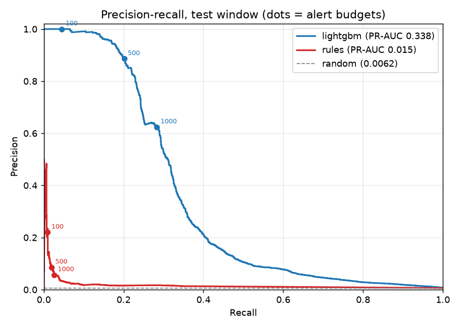

# Day 8 - Baseline model and business evaluation

Test window: 356,396 accounts, 2,201 mules (0.618% base rate). Trained on the earliest 60% of
time, early-stopped and calibrated on the next 20%, scored here on the final 20% (never seen).

## Headline
Judged by what an investigation team catches for a fixed workload, LightGBM vs. the rules engine:

| Alert budget (accounts reviewed) | Rules: mules caught | Rules precision | Rules recall | LightGBM: mules caught | LightGBM precision | LightGBM recall | Extra mules caught | Recall lift |
|---|---|---|---|---|---|---|---|---|
| 100 | 22 | 22.0% | 1.0% | 100 | 100.0% | 4.5% | +78 | 4.55x |
| 500 | 43 | 8.6% | 2.0% | 443 | 88.6% | 20.1% | +400 | 10.30x |
| 1,000 | 57 | 5.7% | 2.6% | 624 | 62.4% | 28.4% | +567 | 10.95x |

Overall ranking quality: PR-AUC **0.338** (LightGBM) vs **0.015** (rules) vs
0.0062 for random. ROC-AUC 0.907 vs 0.607.

## Rules baseline (stands in for the bank's existing rules engine)
Fires when an account trips at least one rule; accounts are ordered by number of rules tripped, then by USD volume.
- **high_passthrough_24h**: `out_within_24h_share >= 0.5` and `txns_out >= 3`
- **many_counterparties**: `counterparties >= 10`
- **balanced_in_out**: `in_out_amount_ratio >= 0.8` and `txns_in >= 2` and `txns_out >= 2`
- **rapid_burst**: `max_txns_in_hour >= 5`

On the test window the rules alert on 62,662 accounts (17.6%), far more than any team can
review, so the order inside the queue is what matters. Thresholds were hand-set by looking at the train/validation
windows only. If the budget exceeds the number of alerts, the rules have nothing more to rank.

## LightGBM
- Early stopping on validation average precision (patience 100); stopped at iteration 1038
  (validation PR-AUC 0.253).
- Class imbalance: `scale_pos_weight=2`. On this temporal split heavy
  weighting was *harmful*: weights of 10 or more stopped at 1-5 trees (val PR-AUC 0.04-0.12) while weight 1-2 trained
  properly (a validation-only sweep; see the comment in `configs/pipeline.yaml`).
- Calibration: Platt (sigmoid) on validation log-odds. It is monotone, so ranking and the table above are unchanged.
  On test it did **not** help (ECE rose): the validation window's mule rate differs from test's (0.65% vs 0.62%), so the fitted offset does not carry over. With weight 2 the raw probabilities were already close to the true rate; use the raw ones unless the rates are re-fit on fresher data.

| Calibration (test) | Raw | Calibrated |
|---|---|---|
| Brier score | 0.00478 | 0.00477 |
| Expected calibration error | 0.00076 | 0.00136 |
| Mean predicted probability (true rate 0.00618) | 0.00653 | 0.00749 |

## How to read this
Investigators care about mules caught per unit of review work. At a budget of 100 accounts the model hands
them 100 mules vs 22 from the rules queue;
at 1,000 it is 624 vs 57.

## Caveats
- Early stopping and Platt calibration share the validation split, so calibration metrics on validation would be
  optimistic; the figures above are on test.
- Test mules: 2,201. At K=100 one extra mule moves precision by 1 point, so small gaps there are noise.
- Window features: "new counterparties" is the number of distinct counterparties inside the window (no earlier
  history is available in this dataset), so the rule is a proxy.
- HI-Small is synthetic; absolute numbers will not transfer to a real bank, the comparison method does.
